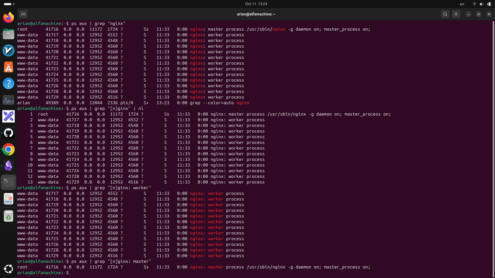

# دیدن پردازه اصلی +‌پردازه کارگر +‌تعدادشون
---
### دیدن پردازه ها با دستور grep
```
ps -aux | grep "[n]ginx:" | nl
---
  1	root       41716  0.0  0.0  11172  1724 ?        Ss   11:33   0:00 nginx: master process /usr/sbin/nginx -g daemon on; master_process on;
     2	www-data   41717  0.0  0.0  12952  4552 ?        S    11:33   0:00 nginx: worker process
     3	www-data   41718  0.0  0.0  12952  4548 ?        S    11:33   0:00 nginx: worker process
     4	www-data   41719  0.0  0.0  12952  4560 ?        S    11:33   0:00 nginx: worker process
     5	www-data   41720  0.0  0.0  12952  4560 ?        S    11:33   0:00 nginx: worker process
     6	www-data   41721  0.0  0.0  12952  4560 ?        S    11:33   0:00 nginx: worker process
     7	www-data   41722  0.0  0.0  12952  4560 ?        S    11:33   0:00 nginx: worker process
     8	www-data   41723  0.0  0.0  12952  4560 ?        S    11:33   0:00 nginx: worker process
     9	www-data   41724  0.0  0.0  12952  4560 ?        S    11:33   0:00 nginx: worker process
    10	www-data   41725  0.0  0.0  12952  4560 ?        S    11:33   0:00 nginx: worker process
    11	www-data   41726  0.0  0.0  12952  4560 ?        S    11:33   0:00 nginx: worker process
    12	www-data   41728  0.0  0.0  12952  4560 ?        S    11:33   0:00 nginx: worker process
    13	www-data   41729  0.0  0.0  12952  4516 ?        S    11:33   0:00 nginx: worker process

```

---
#### دیدن پردازه اصلی یا کارگر
```
worker
--
ps aux | grep "[n]ginx: worker"
=======
master
--
ps aux | grep "[n]ginx: master"

```

---
### عکس از دستوراتی که گفتم
<p align=center>
	
</p>