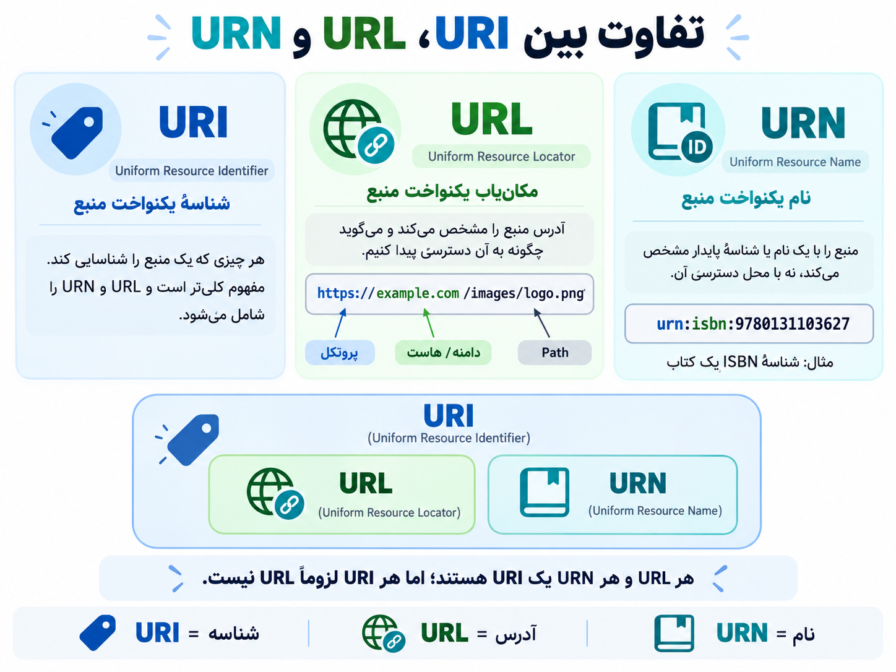

# URIs & URLs & URNs
---
## 1. مخفف هرکدام چیست؟

|عبارت|مخفف|معنی فارسی|
|---|---|---|
|URI|Uniform Resource Identifier|شناسه یکنواخت منبع|
|URL|Uniform Resource Locator|مکان‌یاب یکنواخت منبع|
|URN|Uniform Resource Name|نام یکنواخت منبع|

## 2. هرکدام به زبان ساده چه کاری می‌کنند؟

ا-URI: برای شناسایی یک منبع استفاده می‌شود. مفهوم کلی‌تری است که URL و URN را هم شامل می‌شود.

ا-URL: مشخص می‌کند یک منبع کجاست و چگونه می‌توان به آن دسترسی پیدا کرد. مثل آدرس یک عکس در سایت.

ا-URN: یک منبع را با نام یا شناسه‌ای مشخص می‌کند، بدون اینکه لزوماً محل دسترسی به آن را بگوید. مثل شماره ISBN کتاب.

## 3- یه عکس برایه من درست کن 

	

