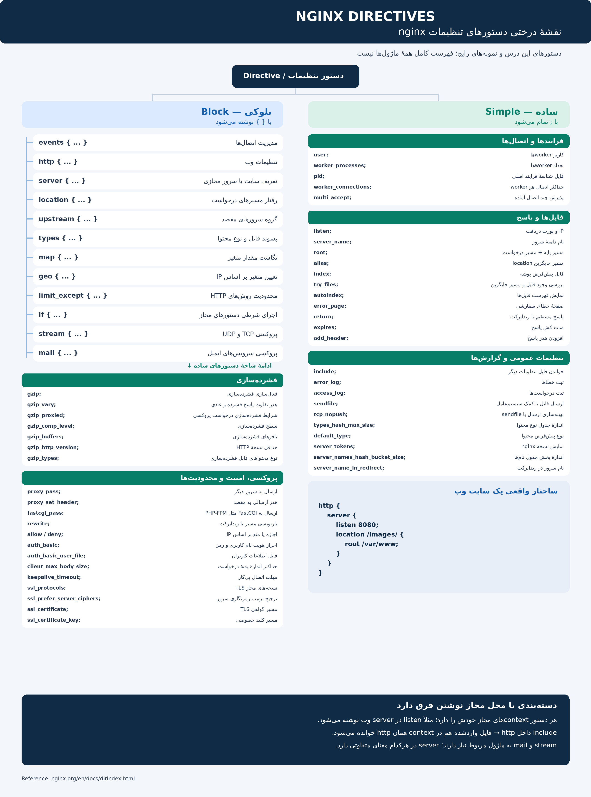

# مقدمه ای بر دایرکتیو ها(directives) که ستون هایه سازنده فایل پیکربندی در nginx هستند
---
## ۱-اول دایرکتیو چیست:
ا-**Directive در nginx یعنی «دستور تنظیمات»**؛ با این دستورها مشخص می‌کنیم nginx چگونه کار کند، روی چه پورتی درخواست بگیرد و فایل‌ها را از کدام مسیر بخواند.

---
## ۲- دایرکتیو هارو میشه به چند دسته تقسیم کرد:

اگر منظورت **دسته‌بندی directiveها از نظر ساختار نوشتن در nginx** است، آن‌ها را به **۲ دستهٔ اصلی** تقسیم می‌کنیم:

|دسته|شکل نوشتن|مثال|
|---|---|---|
|**ساده (Simple)**|نام و مقدار دارد و با `;` تمام می‌شود|`root /var/www;`|
|**بلوکی (Block)**|با `{ }` یک بخش باز می‌کند و دستورهای دیگر داخلش قرار می‌گیرند|`server { ... }`|

مثلاً:

```
http {                     # بلوکی
    server {               # بلوکی
        listen 8080;       # ساده

        location /images/ { # بلوکی
            root /var/www;  # ساده
        }
    }
}
```

یک اصطلاح دیگر هم داریم: **Context** یعنی «محیطی که دستورها داخلش نوشته می‌شوند». بلوک‌هایی مثل `http`، `server` و `location` این محیط‌ها را ایجاد می‌کنند.

پس **از نظر ساختار: ساده و بلوکی**؛ و **context مشخص می‌کند هر دستور کجا مجاز است نوشته شود**.
- پس تا الان
- ۱-دایرکتیو ساده(simple directive): نام مقدار و تمام میشه با ;
- ۲-دایرکتیو هایه بلاکی(block directives): نام و اکولاد و داخلش یه کانتکست بلاکی ایجاد میشه که درون اون کانتکست بلاکی ها دایرکتیو های دیگه رو مینویسی
- ۳-محیط بلاکی(block context): محیطی که توسط بلاک دایرکتیو ها ایجاد میکنی

---
## 3-لیست دایرکتیوها
**۱. دستورهای بلوکی — <mark>Block directives**</mark>

با `{ }` نوشته می‌شوند. بعضی محیط تنظیمات می‌سازند و بعضی جدول یا شرط تعریف می‌کنند.

|دستور|کاربرد کوتاه|
|---|---|
|`events { }`|تنظیم نحوهٔ مدیریت اتصال‌ها|
|`http { }`|تنظیمات مربوط به سرویس‌های وب|
|`server { }`|تعریف یک سایت یا سرور مجازی|
|`location /path/ { }`|تعیین رفتار برای مسیرهای مشخص درخواست|
|`upstream name { }`|تعریف گروهی از سرورهای مقصد برای ارسال درخواست|
|`types { }`|ارتباط پسوند فایل‌ها با نوع محتوا؛ مثل PNG و HTML|
|`map ... { }`|تعیین مقدار یک متغیر بر اساس مقدار متغیر دیگر|
|`geo ... { }`|تعیین مقدار متغیر بر اساس IP|
|`limit_except ... { }`|اعمال محدودیت بر روش‌های HTTP، به‌جز روش‌های نام‌برده|
|`if (...) { }`|اجرای دستورهای مجاز در صورت برقرار بودن شرط|
|`stream { }`|تنظیم پروکسی اتصال‌های TCP و UDP|
|`mail { }`|تنظیم پروکسی سرویس‌های ایمیل|

وجود `stream` یا `mail` به پشتیبانی ماژول مربوط بستگی دارد. همچنین **`server` داخل `http`، `stream` و `mail` کاربرد متفاوتی دارد**.

**۲. دستورهای ساده —<mark> Simple directives**
</mark>
با `;` تمام می‌شوند. ابتدا دستورهایی که در فایل خودت دیدی:

| دستور                                | کاربرد کوتاه                                                             |
| ------------------------------------ | ------------------------------------------------------------------------ |
| `user www-data;`                     | تعیین کاربر اجرای پردازش‌های worker                                      |
| `worker_processes auto;`             | تعیین خودکار تعداد workerها                                              |
| `pid /run/nginx.pid;`                | تعیین فایل ذخیرهٔ شناسهٔ فرایند اصلی                                     |
| `worker_connections 768;`            | حداکثر تعداد اتصال‌های هر worker؛ شامل اتصال به سرورهای مقصد هم می‌شود   |
| `multi_accept on;`                   | پذیرش همهٔ اتصال‌های جدید آماده، در هر نوبت                              |
| `include ...;`                       | خواندن تنظیمات از فایل‌های دیگر                                          |
| `error_log ...;`                     | تعیین محل و سطح ثبت خطاها                                                |
| `access_log ...;`                    | ثبت اطلاعات درخواست‌ها و پاسخ‌ها                                         |
| `sendfile on;`                       | فعال کردن روش سیستم‌عامل برای ارسال فایل                                 |
| `tcp_nopush on;`                     | کمک به ارسال بهینهٔ داده‌ها همراه با `sendfile`                          |
| `types_hash_max_size 2048;`          | تنظیم حداکثر اندازهٔ جدول جست‌وجوی نوع محتوا                             |
| `default_type ...;`                  | نوع پیش‌فرض محتوا وقتی نوع آن مشخص نیست                                  |
| `server_tokens off;`                 | پنهان کردن نسخهٔ nginx در هدر و صفحات خطای تولیدشده                      |
| `server_names_hash_bucket_size ...;` | تنظیم اندازهٔ بخش‌های جدول جست‌وجوی نام سرورها                           |
| `server_name_in_redirect off;`       | کنترل استفاده از نام اصلی سرور در ریدایرکت‌های تولیدشده                  |
| `ssl_protocols ...;`                 | تعیین نسخه‌های مجاز پروتکل TLS                                           |
| `ssl_prefer_server_ciphers on;`      | ترجیح ترتیب الگوریتم‌های رمزنگاری سرور در مذاکره‌های مربوط               |
| `gzip on;`                           | فعال کردن فشرده‌سازی پاسخ‌های مناسب                                      |
| `gzip_vary on;`                      | افزودن هدر مربوط به تفاوت نسخهٔ فشرده و عادی پاسخ                        |
| `gzip_proxied ...;`                  | تعیین شرایط فشرده‌سازی پاسخ به درخواست‌های عبورکرده از پروکسی            |
| `gzip_comp_level ...;`               | تعیین سطح فشرده‌سازی                                                     |
| `gzip_buffers ...;`                  | تعیین بافرهای فشرده‌سازی                                                 |
| `gzip_http_version ...;`             | حداقل نسخهٔ HTTP درخواست برای فشرده‌سازی                                 |
| `gzip_types ...;`                    | تعیین نوع محتواهای قابل فشرده‌سازی؛ HTML به‌طور پیش‌فرض پوشش داده می‌شود |

**دستورهای رایج برای سایت و فایل‌های ثابت:**

|دستور|کاربرد کوتاه|
|---|---|
|`listen 8080;`|تعیین IP یا پورت دریافت درخواست|
|`server_name example.com;`|تعیین نام‌های دامنهٔ سرور|
|`root /var/www;`|تعیین مسیر پایه؛ مسیر درخواست به آن اضافه می‌شود|
|`alias /some/path/;`|تعیین مسیر جایگزین برای بخش مطابق با `location`|
|`index index.html;`|تعیین فایل پیش‌فرض برای درخواست یک پوشه|
|`try_files $uri $uri/ =404;`|بررسی وجود فایل یا پوشه و تعیین نتیجهٔ جایگزین|
|`autoindex on;`|نمایش فهرست فایل‌های پوشه، وقتی فایل index قابل استفاده نیست|
|`error_page 404 /404.html;`|تعیین صفحهٔ پاسخ برای یک خطا|
|`return 404;`|برگرداندن مستقیم کد پاسخ؛ همچنین برای ریدایرکت کاربرد دارد|
|`expires 1d;`|تعیین هدرهای مربوط به مدت نگهداری پاسخ در کش|
|`add_header ...;`|افزودن هدر به پاسخ، طبق شرایط دستور|

**چند دستور رایج برای مراحل بعدی یادگیری:**

|دستور|کاربرد کوتاه|
|---|---|
|`proxy_pass ...;`|فرستادن درخواست به یک سرور دیگر|
|`proxy_set_header ...;`|تعیین هدر درخواست ارسالی به سرور مقصد|
|`fastcgi_pass ...;`|ارسال درخواست به سرویس FastCGI؛ مثل PHP-FPM|
|`rewrite ...;`|بازنویسی مسیر درخواست یا ایجاد ریدایرکت|
|`allow ...;` / `deny ...;`|اجازه یا منع دسترسی بر اساس IP|
|`auth_basic ...;`|فعال کردن احراز هویت با نام کاربری و رمز|
|`auth_basic_user_file ...;`|تعیین فایل اطلاعات کاربران برای احراز هویت|
|`client_max_body_size 10m;`|محدود کردن اندازهٔ بدنهٔ درخواست؛ مثل فایل آپلودی|
|`keepalive_timeout 65s;`|مدت باز نگه داشتن اتصال بی‌کار برای درخواست‌های بعدی|
|`ssl_certificate ...;`|مسیر فایل گواهی TLS|
|`ssl_certificate_key ...;`|مسیر کلید خصوصی گواهی|

---
## ۴-اینم یه عکس برایه جمع بندی دایرکتیو ها و این رو هم توجه کنید درمورد همش صحبت میکنیم

<p align=center>
	
</p>
