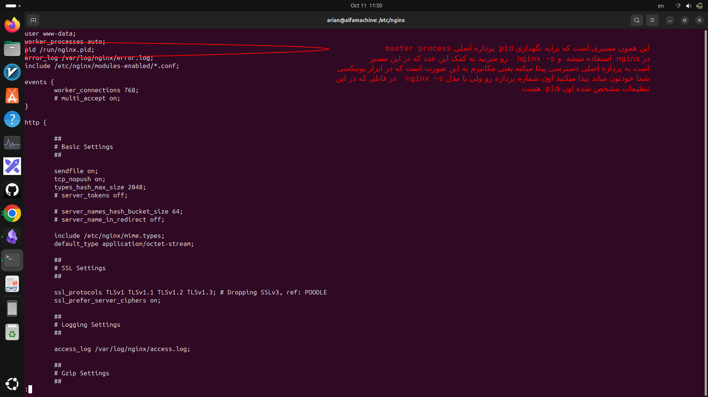

#  روش هایه فرستادن سگنال به پردازه هایه NGINX
---
### ۱-ما کلا چند روش ارسال سیگنال داریم
- ۱- توسط nginx -s (reload, reopen, quit, stop)
- ۲-توسط ابزار هایه یونیکسی  kill -s (signal name) processid

---
### ۲-خب مکانیزم هردو به چه صورت است :
- مدل ۱- در مدل `nginx -s` خود nginx میره در مسیر :
```
/usr/local/nginx/logs/nginx.pid
/var/run/nginx.pid
/run/nginx.pid
```
- یکی از این دوتا که معمولا var/run/nginx.pid/ است بر اساس مدل نصبت این مسیر ها تغییر میکنه میره توش و اون pid مربوط به  master process تون رو برمیداره و بر اساس اون signal name که دادید اون کاری که خواستید رو روش انجام میده
- مدل ۲-در مدل دو دیگه var/run/nginx.pid دیگه در کار نیست و شما باید مستقیما بریدو اون pid مربوط به master process رو پیدا کنید و بهش اون سیگنالی که میخواید رو بفرستید

---
## ۳-مدل ۲- در مدل دو از کجای فایل هایه مربوط به nginx میتونیم مسیر اون جایی که pid پردازه اصلی (master process) درش ذخیره میشه رو ببینیم
- در مسیر فایل کانفیگ nginx که معمولا  در مسیر etc/nginx/nginx.conf است یه cat ازش بگیرید و بید درون قسمت بالایی (main ya global context) اونجایی که تو بلاکی نیست مشاهده میکنید که چیزی مثل این نوشته شده
<p align=center>
	
</p>

-  که این مسیری که جلو simple directive  پردازه نوشته شده همون مسیری است که درونش شماره پردازه مستر ذخیره میشه تا اگه nginx -s  استفاده میکنید دیگه اون شماره پردازه اصلی رو نزنید.

---
### ۴- اینم جدولی از مقایسه  دو مدل یونیکسی و مدل nginx
 اگر **PID پردازهٔ Master برابر `1628`** باشه، معادل اون چهار فرمان اینه:

|کاربرد|دستور Nginx|معادل با ابزار یونیکس|
|---|---|---|
|توقف سریع|`nginx -s stop`|`kill -s TERM 1628`|
|توقف آرام|`nginx -s quit`|`kill -s QUIT 1628`|
|بارگذاری مجدد تنظیمات|`nginx -s reload`|`kill -s HUP 1628`|
|بازکردن دوبارهٔ لاگ‌ها|`nginx -s reopen`|`kill -s USR1 1628`|

**به‌جای `1628`، شناسهٔ واقعی Master در سیستم خودت رو بنویس.** در دستور `kill`، بعد از `-s` نام سیگنال سیستم‌عامل میاد؛ مثلاً معادل `reload`، سیگنال **`HUP`** است. 
